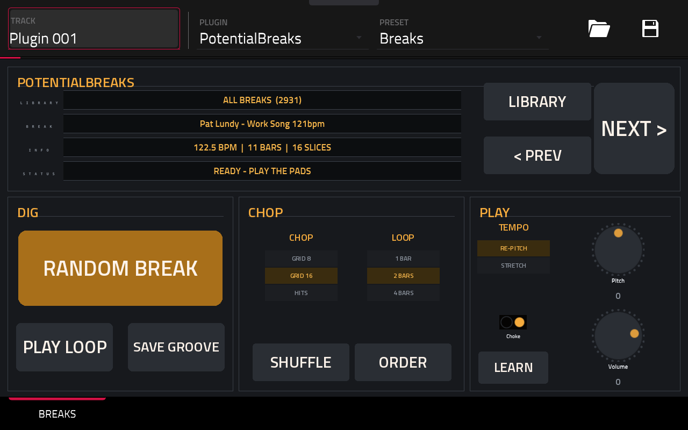

# PotentialBreaks

**Dig, chop, play.** Tap one button for a random drum break from your own library. It's sliced across 16 pads and matched to your project's tempo, ready to flip.

*Instrument plugin · MPC OS 3.x · Gen1 and Gen2 · v1.3.0*

Free and open source (MIT), made by **PotentialBreaks**. It runs inside the MPC like its own instruments, with its own touchscreen page, Q-Link control and project recall, and no computer needed while you play.

**[Download the latest release](../../releases/latest)** · [Install guide](INSTALL-GUIDE.md) · [FAQ](FAQ.md) · [Ideas and bugs](../../issues/new/choose)

## What it does

- **RANDOM BREAK** picks a break from your library. **PREV** and **NEXT** step through them, and **LIBRARY** switches folders.
- **ROLL** picks a random break and a random way to play it (chop, loop length, pad order, pitch). **MILD**, **MEDIUM** or **WILD** next to it sets how far it goes.
- **Long tracks** (a whole drum-library track, say) get a random 1, 2 or 4 bar loop cut from them, starting on a hit. Short files are used as they are.
- **Tempo** comes from the file name when it has one (`Funky Drummer 101bpm.wav` or `... 96 BPM.wav`). Otherwise it's measured.
- **CHOP** gives you 8 or 16 even slices on the beat (moved onto the nearest hit), or the 16 strongest hits. A loop that doesn't split evenly gets whole-beat slices instead, for example 14 slices of 2 beats for a 7-bar loop, so the pads and the saved MIDI stay on the grid.
- **TEMPO** has two modes:
  - **Re-pitch** speeds the break up or slows it down to your tempo, like an old sampler.
  - **Stretch** keeps each slice at its own pitch and cuts it to length, the classic chopped-break method.
- **SHUFFLE** re-deals the slices across the pads, and **ORDER** puts them back.
- **PLAY LOOP** (or the pad after pad 16) plays the whole loop.
- **SAVE GROOVE** writes a MIDI file of the break's original slice order, so you can load it into a sequence and start from the real groove.
- **SAVE KIT** turns the 16 pads into a real **MPC drum program**: each pad saved as a WAV, as you hear it (at your tempo, pitch and shuffle), on pads A01-A16, with the groove beside it as a MIDI file. Load it like any program and keep it after the plugin is gone. MPC OS 3.10.1 or later.
- **CHOKE**, **PITCH** (±12 semitones) and **VOLUME** are here too.
- Your project remembers the break, the chop, the pad order and the settings.

## Where it finds your breaks

You don't have to type any paths. It looks in three places:

1. **A folder called `DRUM BREAKS LIBRARY`** at the top of any drive (SD card, USB drive or SSD).
2. **Any folder at the top of a drive with "break" in its name**, such as `My Breaks` or `Breakbeats`.
3. **Folders you list yourself** in `PotentialBreaks/folders.txt`. The plugin creates this file on your breaks drive the first time it runs, with instructions inside. Put one folder per line, either a full path or a folder on that drive.

Every sub-folder becomes a **library** you can step through with LIBRARY. Files lying loose in a folder make a library of their own. After adding folders, tap **RESCAN**.

WAV and FLAC files are supported.

## Playing it from the pads

The pads play **MIDI notes 36–51** (and 0–15). If pad 1 doesn't play the first slice on your MPC, tap **LEARN** and then hit the pad you want as pad 1. The STATUS line shows the last note received, which helps with setup.

## Three looks

PotentialBreaks comes in three looks: **Print Plate** (the default), **Night Rack** and **Colour Block**. Open the **SETTINGS** page and tap one of the big LOOK keys. The new look shows the next time the plugin loads: take it off the track and add it again, or load your project again. Your choice is kept on your MPC for every project. The sound and the controls are the same in all three.

## Limitations

- **Only the first 3 minutes of a file are used.** This keeps the MPC's memory safe on huge files.
- **The tempo guess for unnamed files is 80–160 BPM.** A 70 BPM break may read as 140. Putting the BPM in the file name avoids this.
- **Stretch mode doesn't time-stretch.** Slices keep their pitch, so at a slower tempo you'll hear small gaps between hits. That's the classic sound, but it isn't a smooth stretch.
- **The automatic chop is a best guess.** On busy or swung breaks some slices may not land exactly on a hit. Try another CHOP mode.
- **8 voices**, and only 44.1 kHz playback.
- **The pads map like a keyboard.** The MPC treats a plugin track like a keyboard, so with some pad bank or octave settings pad 1 isn't note 36. LEARN fixes this.
- **SAVE GROOVE** writes to the first drive your breaks are on, in a `PotentialBreaks` folder.
- **SAVE KIT** writes to `PotentialBreaks/Kits` on that drive. To use your own programs folder instead, put its full path on the first line of `PotentialBreaks/kit-folder.txt` there (for example `/media/SDMPC/My Programs`). Each kit is `<name>.xpm`, its WAVs in `<name>_[ProgramData]`, and `<name>.mid`.
- **Tested on an MPC One only** (Gen1). The 64-bit build for Gen2 MPCs passes Akai's own checks but hasn't been tried on a Gen2 MPC yet.

## Will it work on my MPC?

| | |
|---|---|
| **Tested on** | MPC One (Gen1): with Akai's plugin folder on **MPC OS 3.10.1**, and with the community set-up on HAKAI 3.10 |
| **Should work on** | Any standalone MPC on **MPC OS 3.10.1 or later**: 32-bit (One, One+, Live, Live II, X, Key 61, Key 37) and 64-bit (Live III, XL, One Gen 2, Key 37 Gen 2). Also Gen1 MPCs on older MPC OS 3.x with the community set-up |
| **Not supported** | **MPC OS 2.x** |

The **Should work on** row is untested so far. If you try it on another model, please [tell me how it went](../../issues/new/choose).

## Install

**👉 [Step-by-step install guide](INSTALL-GUIDE.md)**

**On MPC OS 3.10.1 or later** (any standalone MPC, no hacking):
1. Download `PotentialBreaks-<version>-akai-vst2.zip` from [**Releases**](../../releases) and unzip it on your computer.
2. On the MPC, turn on **Preferences → Enhancements (Beta) → Enable Enhancements** and **External Plugin Support**.
3. Copy the folder **PotentialBreaks - VST - PotentialBreaks** into a folder called **VST2 Plugins** at the top of a USB stick, SD card or the internal drive, and restart.
4. It's in **External Plugins**, as an instrument.

**On older MPC OS 3.x (Gen1, community set-up):** download `PotentialBreaks-<version>-mpc-armv7.zip` instead and install it with the free **MPC Plugin Installer** from [Open MPC](https://open-mpc.github.io/), or over SSH (see the guide). Save your project first, because installing restarts the MPC app.

Install it one way only, or it shows up twice. Stuck? The [**FAQ**](FAQ.md) covers the common problems.

## Also good to know

- **Made by one person, tested on one MPC.** It works well for me, but you may hit something I haven't. Please tell me if you do.
- **Plugins must be allowed to run on your MPC.** On MPC OS 3.10.1 or later, that's the **External Plugin Support** switch in Preferences → Enhancements (Beta). On older firmware, your MPC needs the community set-up from [Open MPC](https://open-mpc.github.io/), which you may have to redo after a firmware update.
- **No warranty.** It's free and comes as it is. Back up your projects.

## Ideas, bugs and criticism: all welcome

I make these for myself first, and I want them to be good for everyone else too, so **please tell me what you think**, including what you don't like.

- 💡 [Suggest a feature](../../issues/new?template=idea.yml)
- 🐛 [Report a bug](../../issues/new?template=bug.yml)

You don't need to be technical. Short messages are great. See [CONTRIBUTING.md](CONTRIBUTING.md) for more, including how to send code.

## More from PotentialBreaks

- **[PotentialPatina](https://github.com/PotentialBreakfast/mpc-vst-potentialpatina)**: Retro-colour insert effect: vinyl and tape noise, wobble, drive, bit-crush, tone and room in one box.
- **[PotentialWax](https://github.com/PotentialBreakfast/mpc-vst-potentialwax)**: Melodic sampler: pick or dig a song from your library, 16 cues found for you, matched to your tempo and key.
- **[PotentialNoise](https://github.com/PotentialBreakfast/mpc-vst-potentialnoise)**: Calibrated pink noise reference for mixing: one-tap RMS levels, mono/stereo, full or limited range, live meter.
- **[PotentialPunch](https://github.com/PotentialBreakfast/mpc-vst-potentialpunch)**: Transient shaper: more or less punch and tail on drums and anything else, with one-tap presets.
- **[PotentialHeat](https://github.com/PotentialBreakfast/mpc-vst-potentialheat)**: Soft clipper and bus saturator: warmth, glue and loudness without clipping, with one-tap presets.
- **[PotentialWarp](https://github.com/PotentialBreakfast/mpc-vst-potentialwarp)**: Tempo-locked mangler: stutters, half speed, tape stops, spinbacks, reverses and gates in 16 one-tap patterns.
- **[MPC TOOLS](https://github.com/PotentialBreakfast/mpc-tools)**: a free second-screen app for Windows: your MPC's screen live on your PC (and in OBS), file transfer, your PC's folders on the MPC, and one-click "save the last 60 seconds".

## Build it yourself

See [BUILD.md](BUILD.md).

## Credits

- Built on **[mpc-vst-plugins](https://github.com/sd88me/mpc-vst-plugins)** by sd88me (MIT), the open kit that makes MPC plugins possible: the plugin wrapper, skin builder and installer.
- Audio file reading by **[dr_libs](https://github.com/mackron/dr_libs)** (dr_wav and dr_flac) by David Reid (public domain / MIT-0).
- Fonts: **Jost**, **DM Mono**, **IBM Plex Sans Condensed**, **IBM Plex Mono**, **Bricolage Grotesque** and **Space Mono** (SIL Open Font License 1.1), in `vst/skin/looks/fonts/` with their licences.
- The dark look grew out of the theme I made for sd88me's Lucky Dip.
- Made with help from Claude (Anthropic).

Not affiliated with or endorsed by Akai Professional or inMusic. MPC is their trademark.

## Licence

[MIT](LICENSE): free to use, change and share, including in your own projects. Third-party parts keep their own licences ([THIRD_PARTY.md](THIRD_PARTY.md)).
